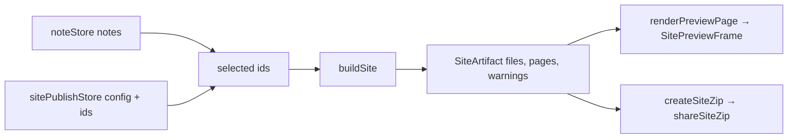

# Site Publishing (Pro)

> Turn selected notes into a themed static website and export it as a ZIP that any static host accepts. Pro only. See [Paywall & Pro Tier](./paywall.md) for entitlement handling.

## What it does

1. **Pick notes** — a checklist of every publishable note (PDF notes are excluded).
2. **Design the site** — presets plus per-field customization, with a live preview.
3. **Preview** — the real generated pages in a sandboxed WebView.
4. **Export ZIP** — shared through the system share sheet; upload it to Netlify Drop, Cloudflare Pages, GitHub Pages, or any static host.

There is no hosting service and no network call: the site is generated entirely on-device.

## Entry points & gating

| Surface | File | Gate |
|---------|------|------|
| Settings → "Publish as website" | `src/components/settings/SettingsContent.tsx` | Free users see a lock and the standard upgrade prompt (`promptProUpgrade`) |
| `PublishSite`, `SiteThemeEditor`, `SitePreview` screens | `src/screens/PublishSiteScreen.tsx`, `SiteThemeEditorScreen.tsx`, `SitePreviewScreen.tsx` | `useProScreenGuard()` — deep links also hit the upgrade alert |
| ZIP export | `shareSiteZip` in `src/services/site/siteExport.ts` | Throws `SiteProRequiredError` unless `selectIsPro(useProStore.getState())` — entitlement is re-checked at the moment of export |
| Paywall feature grid | `src/components/paywall/PaywallFeatureGrid.tsx` | `publishSite` tile |

## Architecture



One `SiteArtifact` feeds both the preview and the ZIP, so what the user previews is what they export.

### Services (`src/services/site/`)

| File | Responsibility |
|------|----------------|
| `siteTypes.ts` | `SiteConfig` (= `SiteDesign` + `SiteIdentity`), enums, `normalizeSiteConfig` |
| `siteThemes.ts` | Six presets (`paper`, `docs`, `journal`, `midnight`, `terminal`, `brutalist`), `applySitePreset`, `applySiteAccent`, `readableTextOn`, font stacks |
| `siteCss.ts` | `buildSiteCss(config)` → `assets/style.css` |
| `siteHtml.ts` | Markdown (via `marked`), Org/Neorg (over `NeorgContentBlock`), JSON renderers; `sanitizeHref`, `escapeHtml` |
| `siteBuilder.ts` | `buildSite`, `renderPreviewPage`, `resolveSitePath` |
| `siteExport.ts` | `createSiteZip`, `shareSiteZip`, `SiteProRequiredError`, `SiteShareUnavailableError` |
| `siteSample.ts` | Sample notes shown in the design preview when nothing is selected |

### State

`src/stores/sitePublishStore.ts` persists `{ config, noteIds }` under `@gitnotes:publish_site` and is hydrated in `App.tsx` next to the other stores. Hydration and every update go through `normalizeSiteConfig`, so corrupt or tampered storage can never reach generated CSS/HTML. A single site is supported. Selected note ids that no longer exist are ignored at build time. The config is kept (not deleted) if a user's Pro entitlement lapses.

### Generated output

```
index.html            home page (list / cards / grid / compact)
notes/<slug>.html     one page per note
assets/style.css      generated from the design config
assets/img-<hash>.*   embedded images, de-duplicated by content
404.html
.nojekyll             GitHub Pages: skip Jekyll processing
sitemap.xml, robots.txt, <link rel="canonical">   only when a public URL is set
```

`index.html` is at the archive root, so the ZIP can be dropped straight onto a host. All internal links are relative; `404.html` uses the path of the public URL (or `/`). Slugs derive from titles and are de-duplicated deterministically (`same`, `same-2`) in creation order, so they are stable across runs.

## Customization

Everything lives on `SiteConfig` and is edited in `SiteThemeEditorScreen`:

- **Preset** — replaces every design field; site identity (title, links, …) is kept.
- **Colors** — color mode (`auto` follows the visitor's OS, or force `light`/`dark`), one accent for both modes, plus per-mode background, surface, text, muted, border, link, and code background. Text on the accent (banner, badges) is picked for contrast.
- **Typography** — body and heading font (system font stacks only, no remote fonts), text size, line spacing, page width.
- **Layout** — corner radius, header style (`left`, `centered`, `banner`, `minimal`), home layout (`list`, `cards`, `grid`, `compact`), link style.
- **Page details** — dates, tags, reading time, table of contents, newer/older links.
- **Identity** (on `PublishSiteScreen`) — title, tagline, author, footer, emoji favicon, header links, optional public URL.
- **Advanced** — custom CSS appended after the theme styles.

## Content rendering & safety

- **Markdown** — `marked` with GFM. Raw HTML in notes is escaped, not rendered. Links are filtered by `sanitizeHref`: only `http(s)`, `mailto`, fragments and relative URLs survive; `javascript:`, `data:`, `gitnotes:` and protocol-relative URLs are dropped (control characters inside the scheme are stripped before the check). A leading `# Title` that repeats the note title is removed.
- **Org / Neorg** — parsed with the existing content parsers and emitted through a shared block renderer with its own inline renderer. Drawers and comments are never published.
- **JSON** — pretty-printed and escaped.
- **Wiki links** (`[[Title]]`, `[[Title|alias]]`) — resolved to the published page with that title; links to unpublished notes render as plain text and add a warning, so no hidden note title leaks into the output.
- **Images** — `https` images keep their URL; `data:` images are written to `assets/`; private-repo `gitnotes://repo-image/…` images are resolved through `resolveGitnotesImageUris` and embedded. Anything else is replaced by its alt text with a warning.
- **Config values** — hex colors, enum members, numeric ranges, URLs (`https` only for the public URL; `http(s)`/`mailto` for header links) are validated in `normalizeSiteConfig`. Custom CSS has any `</style` removed.

The UI warns that everything published (including images) is visible to anyone who can open the hosted site.

## Preview

`SitePreviewFrame` renders pages from the in-memory artifact (CSS inlined, local images as data URIs) in a `WebView` with JavaScript disabled. Navigation is intercepted: links inside the site swap the displayed page, everything else — external URLs, `file:`, `javascript:` — is blocked. The synthetic origin `https://site-preview.invalid/` is never reachable.

## Known limits

- One site per device; no profiles.
- No direct publishing (Git push, hosting) — export a ZIP and upload it.
- Remote `https` images stay remote; PDF notes are skipped; fonts are system fonts only; math blocks are shown as code.
- The preview WebView behaviour on Android (`onShouldStartLoadWithRequest` for the initial HTML load) has only been exercised through unit tests with a mocked WebView.

## Tests

`__tests__/services/site/`, `__tests__/stores/sitePublishStore.test.ts`, `__tests__/components/site/SitePreviewFrame.test.tsx`, `__tests__/screens/PublishSiteScreen.test.tsx`, `__tests__/screens/SiteThemeEditorScreen.test.tsx`.

## See Also

- [Paywall & Pro Tier](./paywall.md)
- [Services](./services.md)
- [Stores](./stores.md)
- [Screens & Navigation](./screens.md)
